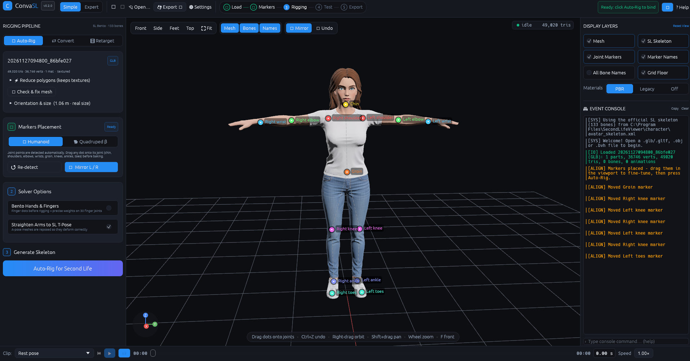
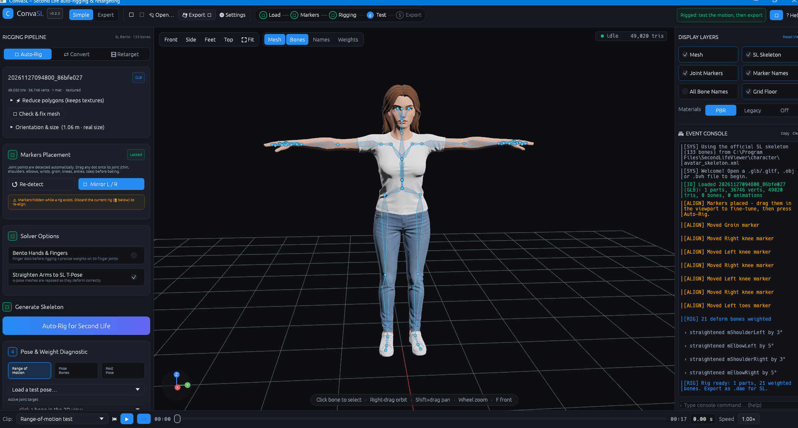
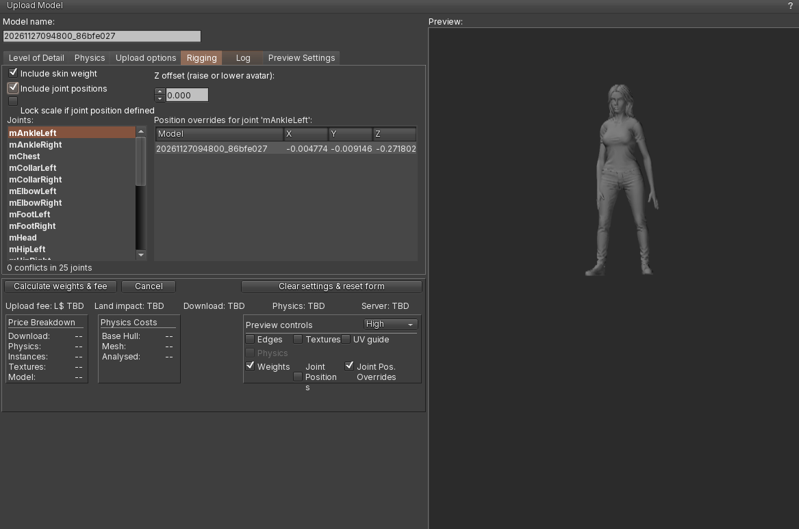

# ConvaSL — downloads

Auto-rigging, rig conversion and animation retargeting for **Second Life**.
Windows 10/11, 64-bit, no installation needed.

This repository only holds the published builds. The source code lives in a
private repository, so nothing here is source — just the signed release files.

| Markers placed automatically | Rigged: the SL skeleton inside the mesh |
|---|---|
|  |  |

Then the shape import and Second Life's own uploader, with the settings ConvaSL asks for:



> [!IMPORTANT]
> **Using the default *Avatar — adult / teen standard* export? Follow the order:**
> **1.** *Orientation & size* → **Fit height** before rigging. **2.** Auto-rig.
> **3.** Export as *Avatar — adult / teen standard* and press **Shape .xml…** to save the `<name>_shape.xml`
> next to the `.dae`. **4.** In Firestorm: wear a modifiable shape, **Edit Shape → Import…** that
> `_shape.xml`, **Save**, then upload the `.dae` with **Include skin weight** ticked and
> **Include joint positions OFF**.
> With those steps it scales correctly. Skip the fit-height or the shape import and the mesh lands too
> big, too small or offset. **Animesh** and **child / baby / custom scale** need no shape — upload those
> with **Include skin weight** *and* **Include joint positions** ticked (plus *Lock scale if joint
> position defined* in the uploader).

## Download

**[Latest release →](https://github.com/Willie2020/ConvaSL-releases/releases/latest)**

1. Open the newest release and download **`ConvaSL-<version>-win64.zip`**.
2. Right-click the zip › *Extract All…* (don't run the exe from inside the zip).
3. Start **`ConvaSL.exe`**. On older PCs, or if you only see a black window,
   start **`ConvaSL_safe_mode.bat`** instead.
4. If Windows shows *"Windows protected your PC"*, click **More info › Run anyway**
   (the build is signed with a self-signed development certificate, so
   SmartScreen still reports an unknown publisher until a commercial
   certificate is used).

`README.txt` inside the zip is the full guide, from a quick start to advanced
details. Every release also ships `SHA256.txt`; the `.cer` file is the public
part of the signing certificate, so you can verify the signature yourself.

## Checking a download

```powershell
Get-FileHash .\ConvaSL.exe -Algorithm SHA256      # compare with SHA256.txt
Get-AuthenticodeSignature .\ConvaSL.exe           # SignerCertificate matches the .cer
```

## What it does

| Tab | Input | Output |
|---|---|---|
| **Auto-Rig** | Unrigged mesh in T- or A-pose (`.glb`, `.gltf`, `.obj`), plus a quadruped beta | Rigged `.dae` for SL upload, or `.glb` |
| **Convert Rig** | Already-skinned character (Mixamo, VRoid/VRM, Ready Player Me, Unreal, Unity, Rigify…) | Rigged `.dae` / `.glb` with SL bone names and joint positions |
| **Retarget Anim** | `.bvh` (CMU, Mixamo, Rokoko, Plask, Qavimator…) or an animated `.glb` | SL-ready `.bvh` |

Also included: texture-safe polygon reduction for AI meshes, automatic mesh
repair, LOD files on export, PBR / Legacy material preview and in-SL shape
previews.

## Feedback

Bug reports and questions are welcome through the download repository's
*Issues* tab. Please say which version you used (it is shown in the window
title) and attach the crash log from `%APPDATA%\ConvaSL\crash.log` if the app
closed on its own.
